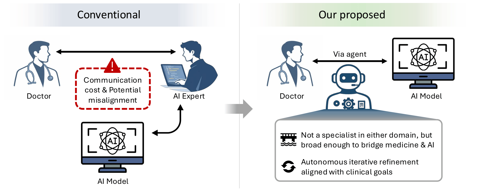
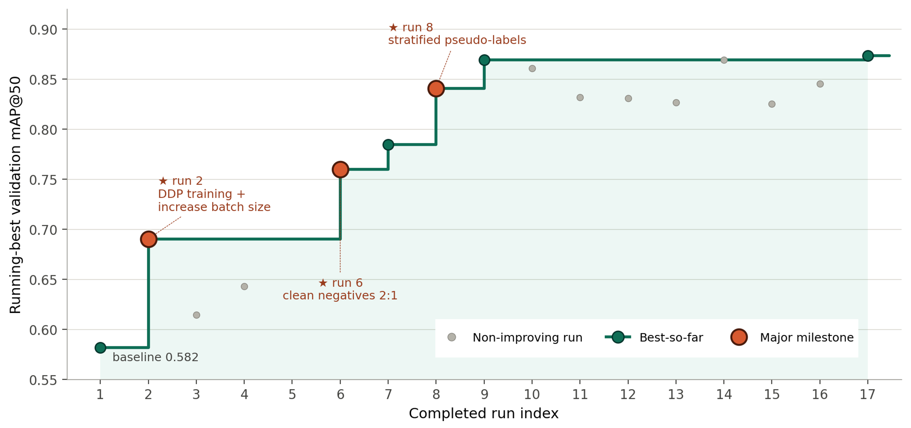

# [arXiv'26] From Clinical Intent to Clinical Model: Autonomous Coding-Agents for Clinician-driven AI Development 🤖
---
Clinical Automata lets a clinician describe a problem in plain language — *"help me diagnose pneumothorax, but don't let the model cheat by looking at chest drains"* — and returns a trained, task-specific deep-learning model. No data-science middleman required. 

<!-- 📄 **Paper:** *From Clinical Intent to Clinical Model: Autonomous Coding-Agents for Clinician-driven AI Development* (Zhao et al., 2026) -->

<div align="center">
  
</div>

> <p align="justify">
> <strong>Comparison between conventional multi-party workflow and our proposed clinician-driven workflow.</strong> In the conventional paradigm, clinicians rely on discussions with AI experts to translate clinical needs into technical implementation, which may incur coordination costs and introduce misalignment because each side lacks deep knowledge of the other's domain. Our proposed framework replaces this intermediate human bottleneck with an autonomous coding agent. Although not a specialist in any single domain, the agent has sufficiently broad knowledge to bridge medicine and AI, while its strong autonomous coding capability makes direct clinician-driven AI development possible.
</p>

---

## Autonomous development
 
The agent proposes a pipeline, and then improve it iteratively through training/validation.Below is a real refinement trajectory on the mixed-supervision wrist-fracture task, where only 5% of training images had bounding boxes. Starting from a 0.582 mAP@50 baseline, the agent climbed to **0.87** by autonomously discovering three key moves: distributed training with a larger batch size (run 2), curated negatives (run 6), and a teacher–student pseudo-labeling strategy that exploited the 95% image-level-only pool (run 8).
 
<!--  -->
<div align="center">
  
</div>

Notably, most of the gain comes from a handful of successful edits out of 30 attempts. The rest edits marked by gray circle are discarded by the acceptance rule.

---

## How it works

A clinician request flows through three stages:

1. **Semantic Parser** — converts the natural-language request into a structured representation capturing the *clinical objective*, *risk preference*, and *output format*.
2. **Task Initializer** — translates that representation into an executable codebase: model architecture, training recipe, evaluation protocol.
3. **Autonomous Developer** — iteratively edits the codebase, runs experiments, inspects failures, and keeps whatever improves a prespecified validation objective. The clinician can inspect choices and negotiate trade-offs along the way.

Under the hood, the three roles are played by a coding agent (Claude Opus 4.6 in our experiments). Each iteration runs a train/validation cycle inside a fixed time budget. The test set is held out from the start and touched exactly once, at the end.

---

## Project structure

```
  clinical-automata/
  ├── README.md                        # This file
  ├── asset/                           # Figures used in README
  ├── projects/                        # Projects shown in the paper: agent code, run logs, manuals, checkpoint links
  └── src/
      ├── clinical-automata-backend/   # The agent harness
      │   ├── Parser.md                # Semantic parser prompt: clinician request → structured task spec
      │   ├── program.md               # Task Initializer & Autonomous Developer prompts
      │   ├── FINALIZE.md              # What the agent does once the experiment loop ends
      │   ├── README.md                # In-repo context provided to the coding agent
      │   ├── prepare.py               # Constants, dataset paths, experiment config
      │   ├── pyproject.toml           # Project metadata and Python dependencies
      │   └── uv.lock                  # Locked dependency versions (uv)
      └── clinical-automata-webui/     # Browser front-end that lets clinicians drive the harness
          ├── backend/                 # FastAPI server that streams the Claude Code CLI session
          ├── frontend/                # React + Vite UI
          ├── datasets.yaml            # Dataset cards shown to clinicians
          └── scripts/                 # Dev / deployment helpers
```

---

## Quick start


```bash

# 1. Install uv project manager (if you don't already have it)
curl -LsSf https://astral.sh/uv/install.sh | sh

# 2. Install dependencies
uv sync

# 3. Download and activate Claude CLI
curl -fsSL https://claude.ai/install.sh | bash

claude --permission-mode bypassPermissions

# 4. Prompt something like
[$your_request$] Please review program.md and start a new experiment. Let us begin with the setup first.
```

> **SLURM users:** the coding agent trains models itself, so the Claude CLI session must run *inside* a GPU allocation. Otherwise the agent cannot see any GPU. Request a GPU job first, then attach your shell to it and start `claude` from there:
>
> ```bash
> sbatch --gres=gpu:1 --wrap "sleep infinity"   # or salloc; add your partition, time, memory
> srun --jobid <JOBID> --overlap --pty bash      # open a shell inside that job
> nvidia-smi                                     # check that the GPU is visible
> claude --permission-mode bypassPermissions
> ```
>
> The web UI's `src/clinical-automata-webui/scripts/start_demo.sh` does this automatically: it finds your running SLURM job and starts the server inside it.


### Configuration

All site-specific values (data paths, secrets, email, domain) live in **one file**. Copy the template and replace every placeholder:

```bash
cp src/config.env.example src/config.env   # src/config.env is git-ignored
```

| Key in `src/config.env` | Placeholder | What to put there |
|---|---|---|
| `DATA_ROOT` | `/path/to/your/datasets` | Root folder holding one sub-folder per dataset, see `DATA_DIR` in `src/clinical-automata-backend/prepare.py` (e.g. `ISIC2019/`, `GRAZPEDWRI-DX/`, `NIH_ChestX-ray14/`). |
| `EXT_DATA_ROOT` | `/path/to/your/external_data` | Writable folder for downloaded weights, cached features and other intermediate files. |
| `CAWEBUI_secret_key` | `CHANGE_ME_SECRET_KEY` | Long random string that signs login cookies and download links, e.g. `python -c "import secrets; print(secrets.token_urlsafe(48))"`. The web UI refuses to start in real mode while this is still the placeholder. |
| `CAWEBUI_access_code` | `CHANGE_ME_ACCESS_CODE` | Fallback site passcode, used only when `src/clinical-automata-webui/access_codes.txt` (one code per line, git-ignored) is absent. |
| `CAWEBUI_owner_email` | `your-email@example.com` | Receives a notification whenever a session starts or is interrupted. |
| `CAWEBUI_smtp_host` / `_port` / `_user` / `_password` | `smtp.example.com`, `your-email@example.com` | SMTP account used to send emails. Leave the password empty to only log emails. |
| `DEMO_HOSTNAME` | `demo.example.com` | Public hostname of the web demo. |
| `CAWEBUI_public_url` | `https://demo.example.com` | Same hostname with `https://`. Used for download links in completion emails. |
| `CF_TUNNEL_NAME` | `your-tunnel-name` | Name of your Cloudflare named tunnel. |
| `CF_CONFIG` | `/path/to/.cloudflared/config.yml` | Config file of that tunnel. |
| `VITE_CONTACT_EMAIL` | `your-email@example.com` | Contact address shown to users in the web UI (all languages). |

Environment variables with the same name override the file.

---

## Projects

The projects shown in the paper are in [`projects/`](projects/). For each one we release the code the agent wrote, its run log (`results.tsv`), the usage manual where available, and a download link for the best checkpoint.

---

## Requirements

- Python ≥ 3.10
- PyTorch ≥ 2.1, CUDA-capable GPU
- Access to a capable coding agent (Claude Opus 4.6 CLI used in the paper)
- During experiments, the coding agent installs dataset- and task-specific packages on demand, so `src/uv.lock` reflects the accumulated state of past runs rather than a clean baseline. For a minimal working environment, refer to the lockfile in [karpathy/autoresearch](https://github.com/karpathy/autoresearch/blob/master/uv.lock).
---

## Citation

If you use this work, please cite:

```bibtex
@article{zhao2026clinicalautomata,
  title   = {From Clinical Intent to Clinical Model: Autonomous Coding-Agents
             for Clinician-driven AI Development},
  author  = {Zhao, Zihao and Cornejo Merodio, Eneko and Zhao, Wenya and Hauke, Frederik
             and Peng, Wensa and Song, Xixi and Bode, Maike and de Castilhos, Juliana
             and Bode, Mathis and Kather, Jakob Nikolas and Nebelung, Sven and Truhn, Daniel},
  year    = {2026}
}
```

---

## Data

All public datasets used in the paper:

- [ISIC 2019](https://challenge.isic-archive.com/data/) — dermoscopic skin lesion classification
- [GRAZPEDWRI-DX](https://doi.org/10.6084/m9.figshare.14825193) — paediatric wrist radiographs, fracture detection
- [PAX-ray++](https://doi.org/10.5281/zenodo.20688438) — chest radiographs, anatomy segmentation
- [PENGWIN 2026](https://doi.org/10.5281/zenodo.19732767) — pelvic CT, fracture fragment segmentation
- [SIIM-ACR Pneumothorax](https://www.kaggle.com/competitions/siim-acr-pneumothorax-segmentation) — chest radiographs, pneumothorax
- [NIH ChestX-ray14](https://nihcc.app.box.com/v/ChestXray-NIHCC) — chest radiographs, pneumothorax
- [NEATX](https://zenodo.org/records/14944064) — chest-drain annotations over a subset of NIH ChestX-ray14
- [CheXpert](https://stanfordmlgroup.github.io/competitions/chexpert/) — chest radiographs, external pneumothorax test
- [VinDr-CXR](https://physionet.org/content/vindr-cxr/1.0.0/) — chest radiographs, external pneumothorax test and grounding
- [ChestX-Det](https://github.com/Deepwise-AILab/ChestX-Det-Dataset) — chest radiographs, pneumothorax grounding
- [CheXlocalize](https://stanfordaimi.azurewebsites.net/datasets/23c56a0d-15de-405b-87c8-99c30138950c) — chest radiographs, pneumothorax grounding

---

## Acknowledgements

We thanks Andrej Karpathy for open-sourcing [autoresearch](https://github.com/karpathy/autoresearch), which inspires this study.

